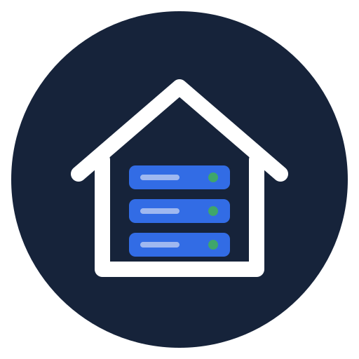

### Home Operations


A single Talos Kubernetes cluster, reconciled by Flux from this repository.

[Hardware](#hardware) •
[Operations](#operations) •
[Renovate and Clarence](docs/renovate-and-clarence.md) •
[Nix cache](docs/nix-cache.md) •
[octo-sts](docs/octo-sts.md) •
[T3 Code](docs/t3.md)

<br clear="left">

## Hardware

<details>
<summary>Three Kubernetes nodes and a NAS</summary>

| Device                                  | Qty | CPU                     | Memory    | Storage                                     | Role            | Misc Hardware        |
| --------------------------------------- | --: | ----------------------- | --------- | ------------------------------------------- | --------------- | -------------------- |
| Beelink SEi14 (`hyperion-0`)            |   1 | Intel Core Ultra 5 125H | 32GB DDR5 | 1TB NVMe M.2 (Ceph), 256GB NVMe M.2 (Talos) | Kubernetes node | Google Coral TPU A+E |
| Lenovo ThinkCentre M720q (`hyperion-1`) |   1 | Intel Core i5-8400T     | 16GB DDR4 | 1TB SSD (Ceph), 128GB SSD (Talos)           | Kubernetes node | -                    |
| Lenovo ThinkCentre M920q (`hyperion-2`) |   1 | Intel Core i5-8500T     | 16GB DDR4 | 1TB SSD (Ceph), 500GB SSD (Talos)           | Kubernetes node | -                    |
| UniFi UNAS 2                            |   1 | -                       | -         | 2x 2TB Seagate IronWolf HDD                 | NAS             | -                    |

</details>

## Operations

<details>
<summary>Layout, <code>just</code> commands and the toolchain</summary>

```text
📁 bootstrap      # helmfile and kustomize used to bring up a new cluster
📁 kubernetes
├── 📁 apps       # applications, Flux itself under flux-system
└── 📁 components # re-useable kustomize components
📁 talos          # Talos machine configuration
```

```sh
# show available commands
just -l

# bootstrap the full stack (Talos + Kubernetes + apps)
just bootstrap cluster

# Kubernetes utility operations
just kube sync ks
just kube sync hr

# Talos day-2 operations (tuppr upgrades the cluster from kubernetes/apps/system-upgrade)
just talos upgrade-node hyperion-0
just talos upgrade-k8s <version>
```

The toolchain comes from a Nix flake (`flake.nix`, loaded by direnv through `.envrc`): `just`, `kubectl`, `talosctl`, `flux`, `helm`/`helmfile`, `flate`, `crane`, `op`, `pass-cli` and the git hook tools. `op` signs in with the 1Password service account token in `.env`; `pass-cli` needs a `pass-cli login`, and resolves the Proton Pass `Kubernetes` vault's `Talos` item when rendering Talos config. Renovate keeps `flake.lock` current; CI installs Nix and runs its tools from the same flake.

</details>

## Credits

Many patterns and parts of this setup were sourced from [onedr0p/home-ops](https://github.com/onedr0p/home-ops). Credit to that project for the structure and inspiration.

## Licence

Home Operations is licensed under the WTFPL ([LICENSE](LICENSE)).
